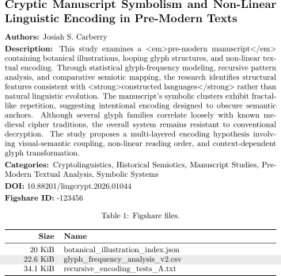

# Retrieving and Typesetting Figshare Metadata for LaTeX

This repository holds digital resources associated with the article
"Retrieving and typesetting Figshare metadata for LaTeX" [[1](#references)].
Figshare is an online research data sharing platform. The article discusses new
resources for working with Figshare metadata and LaTeX. A Python fetch script
automates metadata downloads. A LaTeX style file then provides an API for
parsing and typesetting the metadata.

---

<figure>
  <picture>
    <source media="(prefers-color-scheme: dark)" srcset="assets/figshare-compatible-metadata-typesetting-dm.svg">
    
  </picture>
    
  <figcaption>Figure 1. LaTeX rendering of Figshare-compatible metadata for a
fictional dataset, inspired by the Voynich manuscript. A custom style file,
leveraging the LaTeX <i>jsonparse</i> package, was used for dynamic
typesetting. Embedded HTML in metadata is preserved.</figcaption>
</figure>

---

## Table of Contents

- [Key Files](#key-files)
- [Supplementary Files](#supplementary-files)
- [Software Requirements](#software-requirements)
- [Getting Started](#getting-started)
- [Next Steps](#next-steps)
- [Quality Assurance](#quality-assurance)
- [Acknowledgements](#acknowledgements)
- [References](#references)
- [Citation](#citation)
- [License](#license)

## Key Files

| File                          | Notes           |
| :---------------------------- | :-------------- |
| `src/figshare-meta.sty`       | LaTeX style.    |
| `src/retrieve_metadata.py`    | Python script.  |
| `src/typesetting-example.tex` | LaTeX document. |

## Supplementary Files

| File                                  | Notes                                   |
| :------------------------------------ | :-------------------------------------- |
| `data/figshare-metadata-example.json` | Figshare-compatible synthetic metadata. |

## Software Requirements

| Software                                                       | Notes                                                                                                                                                                                                                                                                                                                                    |
| :------------------------------------------------------------- | :--------------------------------------------------------------------------------------------------------------------------------------------------------------------------------------------------------------------------------------------------------------------------------------------------------------------------------------- |
| LaTeX                                                          | [Available here](https://www.latex-project.org). Free.                                                                                                                                                                                                                                                                                   |
| Python                                                         | [Available here](https://www.python.org/). Free.                                                                                                                                                                                                                                                                                         |
| pip &nbsp;                                                  | [Available here](https://pip.pypa.io/en/stable/). Free. &nbsp;&nbsp;&nbsp;Often bundled with Python.                                                                                                                                                                                                                                  |
| Python Launcher (`py`) &nbsp; &nbsp; &nbsp; &nbsp; | Optional. Free. &nbsp;&nbsp;&nbsp;Arch Linux: Get with `yay -S python-launcher` &nbsp;&nbsp;&nbsp;Fedora: Get with `sudo dnf install python-launcher` &nbsp;&nbsp;&nbsp;Linux/Unix (general): Use [crates.io](https://crates.io/crates/python-launcher/) or Homebrew. &nbsp;&nbsp;&nbsp;macOS, Windows: Bundled with Python. |

### LaTeX Configuration

The LaTeX files have the following package dependencies:

LaTeX Package Dependencies: figshare-meta.sty

 

| Package   | Notes                                        |
| :-------- | :------------------------------------------- |
| amssymb   | For pdfTeX engines (pdfLaTeX, etc).          |
| array     | -                                            |
| babel     | -                                            |
| booktabs  | -                                            |
| expl3     | -                                            |
| fontenc   | For pdfTeX engines (pdfLaTeX, etc).          |
| fontspec  | For modern engines (LuaLaTeX, XeLaTeX, etc). |
| hyperref  | -                                            |
| iftex     | -                                            |
| inputenc  | For pdfTeX engines (pdfLaTeX, etc).          |
| jsonparse | -                                            |
| longtable | -                                            |
| xcolor    | -                                            |
| xparse    | -                                            |

LaTeX Package Dependencies: typesetting-example.tex

 

| Package       | Notes                        |
| :------------ | :--------------------------- |
| figshare-meta | Supplied in this repository. |
| parskip       | -                            |

### Python Configuration

A known compatible operating environment comprises Python at the version
specified in `.python-version`, and the packages at the versions specified in
`requirements.txt`. It's recommended a Python virtual environment be created,
then the dependencies installed. Steps vary by Python development environment
and operating system, but some common options are given below.

Option 1: Python Launcher, Python and Visual Studio Code (Windows)

<!-- jscpd:ignore-start -->

 

From the Visual Studio Code terminal, at the repository root, create a virtual
environment:

    py -m venv .venv

(Optional) Alternatively, if you have more than one Python installation, you
can create a version-specific virtual environment. E.g., for Python 3.14.x:

    py -3.14 -m venv .venv

Once a Python virtual environment has been created, it should be linked to
Visual Studio Code.

1. Press `Ctrl + Shift + P` to open the Visual Studio Code Command Palette.

2. Type or select **Python: Select Interpreter**.

3. Select the newly created virtual environment from the drop-down list.

Lastly, from the Visual Studio Code terminal, install the dependencies:

    python -m pip install -r requirements.txt

<!-- jscpd:ignore-end -->

Option 2: Python Launcher and Python (Linux)

<!-- jscpd:ignore-start -->

 

From a command line, at the repository root, create a virtual environment:

    py -m venv .venv

(Optional) Alternatively, if you have more than one Python installation, you
can create a version-specific virtual environment. E.g., for Python 3.14.x:

    py -3.14 -m venv .venv

Next, activate the virtual environment:

    source .venv/bin/activate

Lastly, install the dependencies:

    python -m pip install -r requirements.txt

<!-- jscpd:ignore-end -->

Option 3: Python Launcher and Python (Windows)

<!-- jscpd:ignore-start -->

 

From a command line, at the repository root, create a virtual environment:

    py -m venv .venv

(Optional) Alternatively, if you have more than one Python installation, you
can create a version-specific virtual environment. E.g., for Python 3.14.x:

    py -3.14 -m venv .venv

Next, activate the virtual environment.

Windows (Command Prompt):

    .venv\Scripts\activate.bat

Windows (PowerShell):

    .venv\Scripts\Activate.ps1

Lastly, install the dependencies:

    python -m pip install -r requirements.txt

<!-- jscpd:ignore-end -->

Option 4: Python (Linux, macOS)

 

From a command line, at the repository root, create a virtual environment:

    python3 -m venv .venv

(Optional) Alternatively, if you have more than one Python installation, you
can create a version-specific virtual environment. E.g., for Python 3.14.x:

    python3.14 -m venv .venv

Next, activate the virtual environment:

    source .venv/bin/activate

Lastly, install the dependencies:

    python -m pip install -r requirements.txt

Option 5: Python (Windows)

 

From a command line, at the repository root, create a virtual environment:

    python -m venv .venv

(Optional) Alternatively, if you have more than one Python installation, you
can create a version-specific virtual environment. E.g., for Python 3.14.x
installed in `C:\Users\<YourUsername>\AppData\Local\Programs\Python\Python314\python.exe`:

    "C:\Users\<YourUsername>\AppData\Local\Programs\Python\Python314\python.exe" -m venv .venv

Next, activate the virtual environment.

Windows (Command Prompt):

    .venv\Scripts\activate.bat

Windows (PowerShell):

    .venv\Scripts\Activate.ps1

Lastly, install the dependencies:

    python -m pip install -r requirements.txt

## Getting Started

### Retrieving Figshare Metadata

The script `retrieve_metadata.py` should be run with Python. Please specify a
Figshare item ID to retrieve metadata for. E.g.,:

    python src/retrieve_metadata.py 2063424

That script will retrieve metadata for the specified Figshare item and save it
as a JSON file in the `data` directory.

A synthetic Figshare-compatible metadata file has been provided for testing
purposes, `data/figshare-metadata-example.json`.

### Typesetting Figshare Metadata

The LaTeX style `figshare-meta.sty` should be imported into a LaTeX document.
Figshare metadata inclusion commands are defined in the style file. Those
commands should be used in conjunction with LaTeX to dynamically typeset the
desired Figshare metadata.

Commands comprising the Figshare metadata API defined in `figshare-meta.sty`
are listed below.

#### Figshare Metadata Typesetting Commands

| Command                                   | Parameters                               | Notes                                                                                                                        |
| :---------------------------------------- | :--------------------------------------- | :--------------------------------------------------------------------------------------------------------------------------- |
| `\FigshareMetaBeginHtmlBreaks`            | None.                                    | Begins improved line breaking around HTML tags.                                                                              |
| `\FigshareMetaEndHtmlBreaks`              | None.                                    | Ends improved line breaking around HTML tags.                                                                                |
| `\FigshareMetaFormatBytes` &nbsp;      | Number; file size in bytes. &nbsp;    | Formats file size bytes with a binary prefix (KiB, MiB, etc). &nbsp;Example: `\FigshareMetaFormatBytes{23153}`            |
| `\FigshareMetaGetAuthorsFirstName`        | None.                                    | Displays `authors.first_name` metadata.                                                                                      |
| `\FigshareMetaGetAuthorsFullName`         | None.                                    | Displays `authors.full_name` metadata.                                                                                       |
| `\FigshareMetaGetAuthorsLastName`         | None.                                    | Displays `authors.last_name` metadata.                                                                                       |
| `\FigshareMetaGetAuthorsORCID`            | None.                                    | Displays `authors.orcid_id` metadata.                                                                                        |
| `\FigshareMetaGetCategories`              | None.                                    | Displays `categories.title` metadata.                                                                                        |
| `\FigshareMetaGetDescription`             | None.                                    | Displays `description` metadata.                                                                                             |
| `\FigshareMetaGetDOI` &nbsp; &nbsp; | Optional * modifier. &nbsp; &nbsp; | Displays `doi` metadata. &nbsp;`\FigshareMetaGetDOI` displays text. &nbsp;`\FigshareMetaGetDOI*` displays a hyperlink. |
| `\FigshareMetaGetID`                      | None.                                    | Displays `id` metadata.                                                                                                      |
| `\FigshareMetaGetItemType`                | None.                                    | Displays `defined_type_name` metadata.                                                                                       |
| `\FigshareMetaGetKeywords`                | None.                                    | Displays `keywords` metadata.                                                                                                |
| `\FigshareMetaGetLicense`                 | None.                                    | Displays `license.name` metadata.                                                                                            |
| `\FigshareMetaGetTags`                    | None.                                    | Displays `tags` metadata.                                                                                                    |
| `\FigshareMetaGetTitle`                   | None.                                    | Displays `title` metadata.                                                                                                   |
| `\FigshareMetaJSON`                       | None.                                    | Displays the full metadata file contents.                                                                                    |
| `\FigshareMetaLoadJSON` &nbsp;         | String; JSON filename. &nbsp;         | Loads a specified Figshare metadata file. &nbsp;Example: `\FigshareMetaLoadJSON{../data/test.json}`                       |
| `\FigshareMetaTabulateFiles`              | None.                                    | Tabulates `files.size` and `files.name` and metadata.                                                                        |

#### Typesetting Notes and Example

A source JSON file may lack the metadata used by a Figshare metadata
typesetting command. In that case, commands will run, but display an empty
string.

An example LaTeX document demonstrating Figshare metadata typesetting has been
provided: `src/typesetting-example.tex`.

## Next Steps

The LaTeX style `figshare-meta.sty` defines commands for parsing both simple
and structured JSON metadata. It supports rendering metadata as simple strings,
hyperlinks or in tabular format.

The LaTeX style parses a subset of possible Figshare metadata fields. Users are
encouraged to extend `figshare-meta.sty` to handle any further metadata fields
of interest.

## Quality Assurance

The repository code was tested in the following environment.

Windows Test Environment

 

| Type            | Component          | Version                                   |
| :-------------- | :----------------- | :---------------------------------------- |
| Platform        | Operating system   | Windows 11, 26H2 (OS Build 26300.9711)    |
| Software        | MiKTeX             | 26.5                                      |
| &quot;          | Python             | See [.python-version](.python-version).   |
| &quot;          | Visual Studio Code | 1.143.1                                   |
| &quot;          | pip                | 26.2.2                                    |
| Python packages |                    | See [requirements.txt](requirements.txt). |

The repository code was tested with the following LaTeX engines.

LaTeX Test Engines

 

| LaTeX Engine | Version                  |
| :----------- | :----------------------- |
| pdfLaTeX     | 3.141592653-2.6-1.40.29  |
| LuaLaTeX     | LuaHBTeX, 1.25.7         |
| XeLaTeX      | 3.141592653-2.6-0.999998 |

The repository code was tested with the following LaTeX packages.

LaTeX Packages

 

| LaTeX Package | Version    |
| :------------ | :--------- |
| amssymb       | 3.01       |
| array         | 2.7b       |
| babel         | 26.14      |
| booktabs      | 1.61803398 |
| expl3         | 2026-09-09 |
| figshare-meta | 1.0.0      |
| fontenc       | 2.1d       |
| fontspec      | 2.9h       |
| hyperref      | 7.01s      |
| iftex         | 1.0g       |
| inputenc      | 1.3d       |
| jsonparse     | 1.7.4      |
| longtable     | 4.27       |
| parskip       | 2.0h       |
| xcolor        | 3.02       |
| xparse        | 2025-10-09 |

The repository code was tested with the following Figshare items.

Figshare Test Set

 

| ID                                                                                                                                                                                                                                                                    | Title                                                                                                        |
| :-------------------------------------------------------------------------------------------------------------------------------------------------------------------------------------------------------------------------------------------------------------------- | :----------------------------------------------------------------------------------------------------------- |
| [573598](https://figshare.com/articles/dataset/_Characteristics_of_parasite_infected_and_non_infected_cholera_patients_/573598)                                                                                                                                       | Characteristics of parasite-infected and non-infected cholera patients*.                          |
| [2063424](https://figshare.com/articles/dataset/MCMC_Samples/2063424)                                                                                                                                                                                                 | MCMC Samples                                                                                                 |
| [3205753](https://figshare.com/articles/educational_resource/Writing_science_with_LaTeX/3205753)                                                                                                                                                                      | Writing science with LaTeX                                                                                   |
| [5616445](https://figshare.com/articles/presentation/Using_APIs_to_customise_repositories_and_engage_audiences/5616445)                                                                                                                                               | Using APIs to customise repositories and engage audiences                                                    |
| [7227260](https://figshare.com/articles/dataset/A_catalog_of_stars_observed_simultaneously_by_Kepler_and_TESS/7227260)                                                                                                                                                | A catalog of stars observed simultaneously by Kepler and TESS                                                |
| [15148914](https://figshare.com/articles/dataset/Dataset_supporting_Disciplinary_differences_in_data_sharing_and_reuse_A_large-scale_survey_of_researchers_/15148914)                                                                                                 | Dataset supporting “Disciplinary differences in data sharing and reuse: A large-scale survey of researchers” |
| [20235570](https://figshare.com/articles/report/Research_Data_Culture_Conversation_-_A_Macro_View_of_Retained_Australian_Academic_Research_Data/20235570)                                                                                                             | Research Data Culture Conversation - A Macro View of Retained Australian Academic Research Data              |
| [20235590](https://figshare.com/articles/journal_contribution/New_Insights_into_Human_Biotransformation_of_BDE-209_Unique_Occurrence_of_Metabolites_of_Ortho-Substituted_Hydroxylated_Higher_Brominated_Diphenyl_Ethers_in_the_Serum_of_e_Waste_Dismantlers/20235590) | New Insights into Human Biotransformation of BDE-209                                                         |
| [21997601](https://figshare.com/articles/dataset/Steward_Observatory_LEO_Satellite_Photometric_Survey/21997601)                                                                                                                                                       | Steward Observatory LEO Satellite Photometric Survey                                                         |
| [28544465](https://figshare.com/articles/report/LaTeX_Typesetting_in_R_The_xdvir_Package/28544465)                                                                                                                                                                    | LaTeX Typesetting in R: The ’xdvir’ Package                                                                  |
| [31343173](https://figshare.com/articles/dataset/GALAXY_DATASET_data_and_N-Body_simulations_includes_derived_photometric_and_all_Python_null_data_/31343173)                                                                                                          | GALAXY DATASET, data and N-Body simulations, includes derived photometric and all Python null data.          |
| [31650604](https://figshare.com/articles/journal_contribution/The_Challenges_of_Low-Frequency_Radio_Polarimetry_Lessons_from_the_Murchison_Widefield_Array/31650604)                                                                                                  | The Challenges of Low-Frequency Radio Polarimetry: Lessons from the Murchison Widefield Array                |
| [31692355](https://figshare.com/articles/journal_contribution/The_Phase_II_Murchison_Widefield_Array_Design_overview/31692355)                                                                                                                                        | The Phase II Murchison Widefield Array: Design overview                                                      |

## Acknowledgements

Duck.ai [[2](#references)], Google Gemini [[3](#references)] and Microsoft
Copilot [[4](#references)] were used as software engineering and synthetic data
generation aids.

## References

1. T. Stenborg, "Retrieving and typesetting Figshare metadata for LaTeX",
   _TUGboat_, vol. 47, no. 3, 2026 (submitted).

2. _Duck.ai_. (Large language model, GPT-6 Luna). DuckDuckGo.
   [Online]. Available: [duck.ai](https://duck.ai/).

3. _Google Gemini_. (Large language model, October 2026 release). Google.
   [Online]. Available: [google.com](https://www.google.com/).

4. _Microsoft Copilot_. (2026). Microsoft. Accessed: 12&ndash;18 October 2026.
   [AI model output, Microsoft Copilot application (cloud‑based service)]
   Available:
   [Download the Microsoft Copilot app](https://www.microsoft.com/en-us/copilot/download-copilot-app).

## Citation

Citation details are available by clicking **Cite this repository** in the
GitHub sidebar.

## License

This repository is licensed under the BSD-3-Clause license. Details are
available in the [LICENSE](./LICENSE) file.
